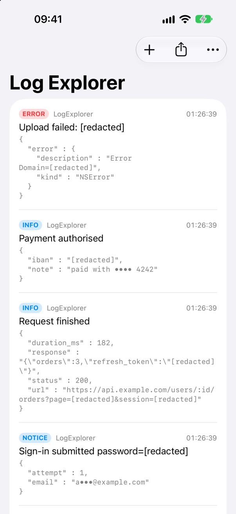
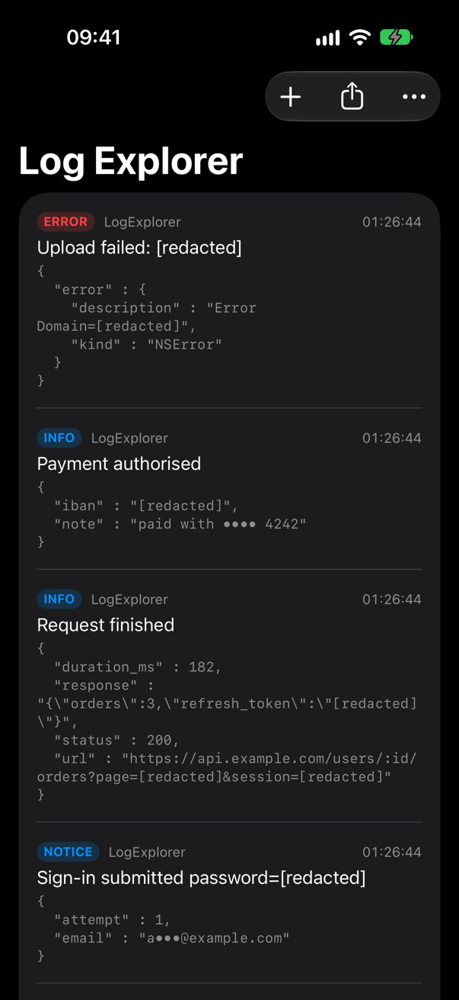

<!-- i18n-source: README.md@8e97ff5e024616dc4fc4a56edaa1f454b20857ec status=reviewed -->
<!-- brand:start -->

<p align="center"><picture><source media="(prefers-color-scheme: dark)" srcset="https://raw.githubusercontent.com/muhittincamdali/MobileLogger/main/.github/brand/banner-dark.svg"><source media="(prefers-color-scheme: light)" srcset="https://raw.githubusercontent.com/muhittincamdali/MobileLogger/main/.github/brand/banner-light.svg"></picture></p>

<!-- lang-selector:start -->
<p align="center"><a href="README.md">English</a> · <a href="README.tr.md">Türkçe</a> · <a href="README.zh-CN.md">简体中文</a> · <a href="README.ja.md">日本語</a> · <a href="README.ko.md">한국어</a> · <a href="README.es.md">Español</a> · <a href="README.de.md">Deutsch</a> · <a href="README.fr.md">Français</a> · <a href="README.pt-BR.md">Português (Brasil)</a> · <a href="README.ru.md">Русский</a></p>
<!-- lang-selector:end -->

<p align="center">
<a href="https://github.com/muhittincamdali/MobileLogger/actions/workflows/ci.yml"></a>
<a href="https://github.com/muhittincamdali/MobileLogger/releases"><picture><source media="(prefers-color-scheme: dark)" srcset="https://raw.githubusercontent.com/muhittincamdali/MobileLogger/main/.github/brand/badge-version-dark.svg"><source media="(prefers-color-scheme: light)" srcset="https://raw.githubusercontent.com/muhittincamdali/MobileLogger/main/.github/brand/badge-version-light.svg"></picture></a>
<a href="https://github.com/muhittincamdali/MobileLogger/blob/main/Package.swift"><picture><source media="(prefers-color-scheme: dark)" srcset="https://raw.githubusercontent.com/muhittincamdali/MobileLogger/main/.github/brand/badge-platforms-dark.svg"><source media="(prefers-color-scheme: light)" srcset="https://raw.githubusercontent.com/muhittincamdali/MobileLogger/main/.github/brand/badge-platforms-light.svg"></picture></a>
<a href="https://github.com/muhittincamdali/MobileLogger/blob/main/Package.swift"><picture><source media="(prefers-color-scheme: dark)" srcset="https://raw.githubusercontent.com/muhittincamdali/MobileLogger/main/.github/brand/badge-language-dark.svg"><source media="(prefers-color-scheme: light)" srcset="https://raw.githubusercontent.com/muhittincamdali/MobileLogger/main/.github/brand/badge-language-light.svg"></picture></a>
<a href="https://github.com/muhittincamdali/MobileLogger/blob/main/LICENSE"><picture><source media="(prefers-color-scheme: dark)" srcset="https://raw.githubusercontent.com/muhittincamdali/MobileLogger/main/.github/brand/badge-license-dark.svg"><source media="(prefers-color-scheme: light)" srcset="https://raw.githubusercontent.com/muhittincamdali/MobileLogger/main/.github/brand/badge-license-light.svg"></picture></a>
</p>

<p align="center">
<a href="#démarrage-rapide"><picture><source media="(prefers-color-scheme: dark)" srcset="https://raw.githubusercontent.com/muhittincamdali/MobileLogger/main/.github/brand/button-start-fr-dark.svg"><source media="(prefers-color-scheme: light)" srcset="https://raw.githubusercontent.com/muhittincamdali/MobileLogger/main/.github/brand/button-start-fr-light.svg"></picture></a>
<a href="https://muhittincamdali.github.io/MobileLogger/documentation/mobilelogger/"><picture><source media="(prefers-color-scheme: dark)" srcset="https://raw.githubusercontent.com/muhittincamdali/MobileLogger/main/.github/brand/button-docs-fr-dark.svg"><source media="(prefers-color-scheme: light)" srcset="https://raw.githubusercontent.com/muhittincamdali/MobileLogger/main/.github/brand/button-docs-fr-light.svg"></picture></a>
<a href="https://github.com/muhittincamdali/MobileLogger/tree/main/Examples"><picture><source media="(prefers-color-scheme: dark)" srcset="https://raw.githubusercontent.com/muhittincamdali/MobileLogger/main/.github/brand/button-examples-fr-dark.svg"><source media="(prefers-color-scheme: light)" srcset="https://raw.githubusercontent.com/muhittincamdali/MobileLogger/main/.github/brand/button-examples-fr-light.svg"></picture></a>
</p>

> Ceci est une traduction du README anglais. En cas de différence, la version anglaise fait foi.

<!-- brand:end -->

MobileLogger est un package Swift de journalisation structurée pour les apps iOS, macOS, tvOS, watchOS et visionOS, qui masque les secrets avant que quoi que ce soit ne soit écrit. Chaque message et chaque valeur de metadata passe par le module de masquage défini dans une spécification commune et écrite, de sorte que unified logging, les stockages sur l’appareil et un fichier exporté contiennent le même texte sûr. Il s’adresse aux équipes d’apps dont les logs quittent l’appareil : joints à des rapports de bug, envoyés par le support ou lus depuis un sysdiagnose. Il écrit dans `os.Logger`, conserve les logs en mémoire ou sur disque dans des limites fixes, les exporte pour `ShareLink` et masque aussi les logs des packages qui utilisent swift-log.

## Points forts

- **Masquage sur chaque chemin** — les messages, les clés et valeurs de metadata, les URL et les corps HTTP passent par `SensitiveDataRedactor` d’[iOSSecurityTools](https://github.com/muhittincamdali/iOSSecurityTools), l’implémentation de référence de la spécification de masquage : noms de secrets, numéros de carte (Luhn), IBAN (mod-97), adresses e-mail, JSON Web Tokens, tokens bearer et tokens longs.
- **Vérifié par rapport à la spécification** — le jeu de tests obligatoire de la spécification et son corpus de 7 866 entrées adverses passent par les propres points d’entrée du logger ; la sortie doit être égale à celle du module de masquage de référence pour chaque entrée, et l’export ne doit pas ajouter ce qu’il masque.
- **Limites fail-closed** — les messages trop volumineux, les metadata imbriquées sur plus de 64 niveaux ou de plus de 256 KiB, et les URL trop longues sont masqués en entier au lieu d’être à moitié lus ; NaN, l’infini et `Int.min` ne provoquent jamais de trap.
- **Stockages bornés** — `MemoryLogStore` garde les enregistrements les plus récents dans un budget de nombre et d’octets, `FileLogStore` fait tourner un nombre fixe de fichiers JSON Lines, et tous deux comptent ce qu’ils suppriment au lieu de grossir.
- **Export prêt à partager** — `LogArchive` écrit du JSON Lines ou du texte, filtré par niveau et par date, et se conforme à `Transferable` pour `ShareLink`.
- **Passerelle swift-log** — `RedactingLogHandler` envoie les logs de chaque package qui utilise swift-log par le même module de masquage et les mêmes stockages.

## Démarrage rapide

**1. Ajouter le paquet**

Dans Xcode, choisissez **File › Add Package Dependencies…** et saisissez l’URL du dépôt :

```text
https://github.com/muhittincamdali/MobileLogger.git
```

Collez-la dans le champ de recherche en haut à droite de la fenêtre. Laissez **Dependency Rule** sur **Up to Next Major Version** à partir de `2.0.0`, puis cliquez sur **Add Package**. Dans la fenêtre suivante, choisissez la cible de votre app à côté de **MobileLogger** et cliquez de nouveau sur **Add Package**.

**2. Importer le module**

```swift
import MobileLogger
```

Placez cette ligne en haut du fichier Swift où vous journalisez.

**3. L’utiliser**

Créez un logger par fonctionnalité et journalisez un message dont les données sont dans les metadata :

```swift
import MobileLogger

extension MobileLogger {
    /// One logger per feature; make it once and use it anywhere.
    static let checkout = MobileLogger(category: "Checkout")
}

func quickStart() {
    MobileLogger.checkout.info("Payment sent", metadata: [
        "status": 200,
        "note": "paid with 4242 4242 4242 4242",
        "email": "alice@example.com",
        "password": "hunter2",
    ])
    // Xcode's console and Console.app show:
    // Payment sent {"email":"a•••@example.com","note":"paid with •••• 4242","password":"[redacted]","status":200}
}
```

Appelez `quickStart()` depuis un bouton ou `.task`, lancez l’app et regardez la console de Xcode.

## Installation

### Swift Package Manager

Dans Xcode, choisissez **File › Add Package Dependencies…** et saisissez l’URL du dépôt :

```text
https://github.com/muhittincamdali/MobileLogger.git
```

Ou ajoutez-le aux `dependencies` de votre `Package.swift` :

```swift
dependencies: [
    .package(url: "https://github.com/muhittincamdali/MobileLogger.git", from: "2.0.0")
],
targets: [
    .target(name: "YourApp", dependencies: [
        .product(name: "MobileLogger", package: "MobileLogger"),
        // Only if the app or its packages log with swift-log:
        .product(name: "MobileLoggerSwiftLog", package: "MobileLogger"),
    ])
]
```

Le package dépend d’[iOSSecurityTools](https://github.com/muhittincamdali/iOSSecurityTools) (le module de masquage) et de [swift-log](https://github.com/apple/swift-log) (utilisé uniquement par le produit `MobileLoggerSwiftLog`).

## Utilisation

Les exemples ci-dessous sont copiés de [`ReadmeSamples.swift`](Examples/LogExplorer/LogExplorer/ReadmeSamples.swift) et de [`ReadmeSwiftLogSample.swift`](Examples/LogExplorer/LogExplorer/ReadmeSwiftLogSample.swift), que l’app d’exemple et les tests compilent ; les tests vérifient chaque sortie indiquée dans les commentaires.

### Écrire des messages et des metadata

Un message est un texte libre avec un seul point de coupure : la première clé non autorisée, ou le premier nom de secret, masque le reste. Gardez le message sous forme d’une phrase constante et placez les valeurs dans les metadata, où chaque clé est jugée séparément.

```swift
func messagesAndMetadata(log: MobileLogger) {
    // A message is free text: the first key that is not allowed hides the rest of it.
    log.info("Signed in user=alice")                  // Signed in user=[redacted]
    log.info("GET /orders status=200 duration_ms=41") // kept: status, duration_ms are allowed

    // Metadata keeps values under keys that name no secret.
    log.info("Signed in", metadata: ["user": "alice", "attempt": 2])
    // Signed in {"attempt":2,"user":"alice"}
}
```

### Journaliser des URL et des corps HTTP

`.url` supprime le nom d’utilisateur, le mot de passe et le fragment, remplace les identifiants du chemin par `:id` et masque les valeurs de la requête. `.body` lit les corps JSON, de formulaire, multipart et en texte brut d’après leur content type, et omet tout autre corps.

```swift
func urlsAndBodies(log: MobileLogger) {
    let url = URL(string: "https://bob:pw@api.example.com/users/12345678/orders?page=2#top")!
    let body = Data(#"{"id":7,"access_token":"eyJhbGciOiJIUzI1NiJ9.e30.x","items":3}"#.utf8)
    log.info("Request finished", metadata: [
        "url": .url(url),
        "status": 200,
        "response": .body(body, contentType: "application/json"),
    ])
    // Request finished {"response":"{\"id\":7,\"access_token\":\"[redacted]\",\"items\":3}",
    //   "status":200,"url":"https://api.example.com/users/:id/orders?page=[redacted]"}
}
```

### Conserver les logs et les exporter

```swift
func storesAndExport() async throws -> LogArchive {
    let memory = MemoryLogStore(capacity: 2_000)
    let disk = FileLogStore() // Library/Caches/MobileLogger, 4 files of 1 MiB
    let log = MobileLogger(category: "Sync", sinks: [OSLogSink(), memory, disk])

    log.error("Upload failed", metadata: ["error": .error(URLError(.timedOut)), "attempt": 3])

    // Everything a store holds was redacted when it was logged.
    return try await LogArchive.make(from: disk, format: .text, minimumLevel: .warning)
}
```

Remettez l’archive à `ShareLink(item: archive, preview: SharePreview(archive.fileName))`, ou écrivez-la dans un dossier avec `archive.write(to:)`.

### Faire passer swift-log par le redactor

```swift
/// Sends the logs of every package that uses swift-log through the redactor. Call it once,
/// early in the app's life: swift-log accepts one bootstrap per process.
func bootstrapSwiftLog(store: MemoryLogStore) {
    let base = MobileLogger(sinks: [OSLogSink(), store])
    LoggingSystem.bootstrap { label in RedactingLogHandler(label: label, logger: base) }

    let logger = Logger(label: "com.example.sync")
    logger.info("Sync finished", metadata: ["token": "abc123", "items": "42"])
    // Sync finished {"items":"42","token":"[redacted]"}
}
```

### Autoriser plus là où il le faut

Les réglages par défaut masquent le plus. Une `RedactionPolicy` peut laisser passer davantage, mais elle ne peut pas désactiver la règle des noms de secrets ni les détecteurs.

```swift
func policy() -> MobileLogger {
    let policy = RedactionPolicy(
        allowedTextKeys: ["screen", "attempt"],  // read on after these keys in messages
        allowedQueryParameters: ["page", "sort"] // keep these query values in URLs
    )
    return MobileLogger(category: "Catalog", policy: policy, sinks: [OSLogSink(), MemoryLogStore()])
}
```

## Quand utiliser autre chose

| Vous avez besoin de                                              | Utilisez                                                                                                                                            |
| ---------------------------------------------------------------- | --------------------------------------------------------------------------------------------------------------------------------------------------- |
| Une API de journalisation pour une bibliothèque que vous publiez | [swift-log](https://github.com/apple/swift-log) ; les apps le font ensuite passer par `RedactingLogHandler`                                         |
| Un inspecteur réseau avec une interface de console               | [Pulse](https://github.com/kean/Pulse) ; il ne masque que les headers, les éléments de requête et les champs JSON que vous nommez, pas les messages |
| Des logs qui ne quittent jamais unified logging                  | `os.Logger` avec `privacy:` sur chaque interpolation                                                                                                |
| Une base de code Objective-C qui l’utilise déjà                  | [CocoaLumberjack](https://github.com/CocoaLumberjack/CocoaLumberjack)                                                                               |
| La journalisation sur des serveurs Linux                         | swift-log avec un handler serveur ; MobileLogger utilise OSLog et ne fonctionne que sur les plateformes Apple                                       |

L’article [Choosing a logger](https://muhittincamdali.github.io/MobileLogger/documentation/mobilelogger/choosingalogger) explique chaque cas et comment les combiner.

## Démo

| Clair                                                                                                | Sombre                                                                                               |
| ---------------------------------------------------------------------------------------------------- | ---------------------------------------------------------------------------------------------------- |
|  |  |

L’app d’exemple [LogExplorer](Examples/LogExplorer) journalise quatre événements qui contiennent des secrets, comme les apps le font souvent par erreur, et liste ce que ses sinks ont reçu. Ouvrez `Examples/LogExplorer/LogExplorer.xcodeproj` dans Xcode, choisissez un simulateur d’iPhone ou **My Mac**, appuyez sur **Run** et journalisez des événements avec le bouton **+** ; le bouton de partage les exporte. Les captures d’écran sont prises dans l’app par [`scripts/capture-example-screens.sh`](scripts/capture-example-screens.sh) ; [Examples/README.md](Examples/README.md) donne les détails.

## Documentation

Référence de l’API et articles :

- [API reference](https://muhittincamdali.github.io/MobileLogger/documentation/mobilelogger/) — chaque type public, généré avec DocC et publié par le workflow de documentation.
- La spécification de masquage que suit le package est implémentée et documentée dans [iOSSecurityTools](https://github.com/muhittincamdali/iOSSecurityTools).

## Guides

- [Getting started](https://muhittincamdali.github.io/MobileLogger/documentation/mobilelogger/gettingstarted) — de l’ajout du package à des logs masqués, conservés et exportés.
- [Redaction rules](https://muhittincamdali.github.io/MobileLogger/documentation/mobilelogger/redactionrules) — comment les messages, les metadata, les URL et les corps sont lus, et ce qui n’est pas détecté.
- [Exporting logs](https://muhittincamdali.github.io/MobileLogger/documentation/mobilelogger/exportinglogs) — limites des stockages, formats d’archive, `ShareLink` et sinks personnalisés.
- [Choosing a logger](https://muhittincamdali.github.io/MobileLogger/documentation/mobilelogger/choosingalogger) — quand `os.Logger`, swift-log, Pulse ou CocoaLumberjack convient mieux.

## Prérequis

| Plateforme | Version minimale |
| --- | --- |
| iOS | 18 |
| macOS | 15 |
| tvOS | 18 |
| watchOS | 11 |
| visionOS | 2 |
| Chaîne d’outils | Swift 6.2 · Xcode 26+ |

La CI compile avec le Xcode par défaut de l’image de runner `macos-26` de GitHub. Le package est développé avec Xcode 27.

## Architecture

```text
log.info(message, metadata)
  └─ MobileLogger ── level check, then RecordRedactor
       ├─ message   → SensitiveDataRedactor.redact(_:)          free text, one cut point
       ├─ metadata  → one JSON object → redact(body:"application/json")
       │    ├─ .url  → redact(url:)    put back only where its key keeps it
       │    └─ .body → redact(body:contentType:)
       └─ LogRecord (redacted) → every LogSink
            ├─ OSLogSink        os.Logger, public
            ├─ MemoryLogStore   count + byte budget
            └─ FileLogStore     rotating JSON Lines → LogArchive → ShareLink
```

- `Sources/MobileLogger` contient le logger, les types d’enregistrement, les sinks (`Sinks/`) et l’export (`Export/`). `Sources/MobileLoggerSwiftLog` contient le handler swift-log, un produit séparé pour que les apps sans swift-log ne le lient pas.
- Le masquage a lieu une seule fois, sur le thread qui journalise, avant l’appel de tout sink. Les sinks ne voient jamais que des valeurs `LogRecord` : un nouveau sink ne peut donc pas divulguer ce que le module de masquage a masqué.
- Dans le JSON des metadata, une URL ou un corps est représenté par un mot repère. Ce n’est que lorsque ce mot revient inchangé (sa clé et ses voisins ne masquent rien) que l’URL ou le corps masqué séparément est remis à sa place ; partout ailleurs, la valeur reste masquée.
- Chaque limite est fail-closed : une fois dépassée, le logger masque ou supprime davantage, jamais moins, et compte ce qu’il supprime.
- Les tests utilisent Swift Testing et s’exécutent sur macOS et dans un simulateur d’iPhone : le jeu obligatoire et le corpus de la spécification, le pipeline des metadata, les stockages, l’export, la passerelle swift-log, les exemples du README et un aller-retour par unified logging avec `OSLogStore`.

Exécutez les tests en local :

```sh
swift test                                    # macOS
xcodebuild test -scheme MobileLogger-Package \
  -destination 'platform=iOS Simulator,name=iPhone 17'
```

## Feuille de route

- Un visualiseur de logs SwiftUI prêt à l’emploi, construit à partir de la liste de l’app d’exemple.
- Une conservation fondée sur la durée pour `FileLogStore`, en plus des limites de taille et de nombre.
- L’ajout du package au Swift Package Index ; `.spi.yml` est déjà dans le dépôt.

## Contribuer

Les contributions sont les bienvenues. Lisez le [guide de contribution](https://github.com/muhittincamdali/MobileLogger/blob/main/CONTRIBUTING.md) et le [code de conduite](https://github.com/muhittincamdali/.github/blob/main/CODE_OF_CONDUCT.md) avant d’ouvrir une pull request. Signalez les problèmes de sécurité en privé, comme indiqué dans la [politique de sécurité](https://github.com/muhittincamdali/MobileLogger/blob/main/SECURITY.md).

## Licence

Publié sous licence MIT. Voir [LICENSE](LICENSE).
